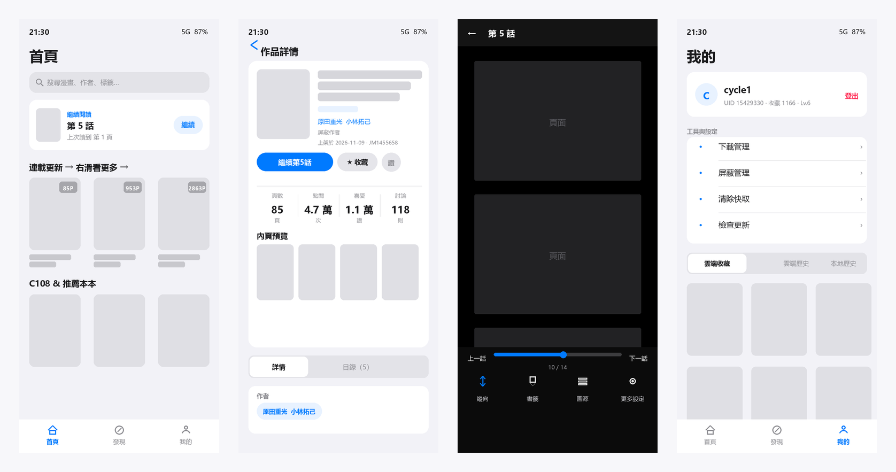
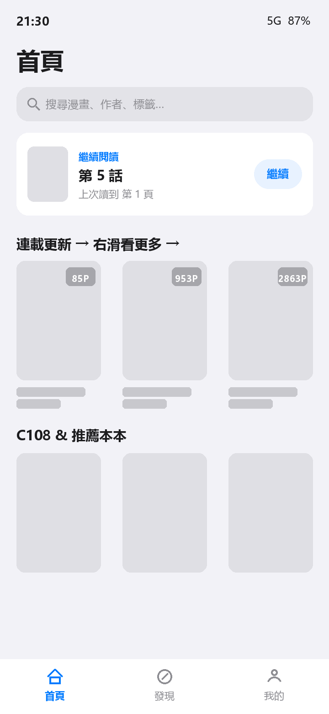
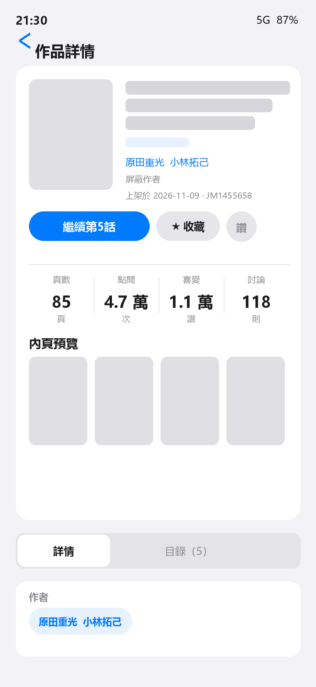
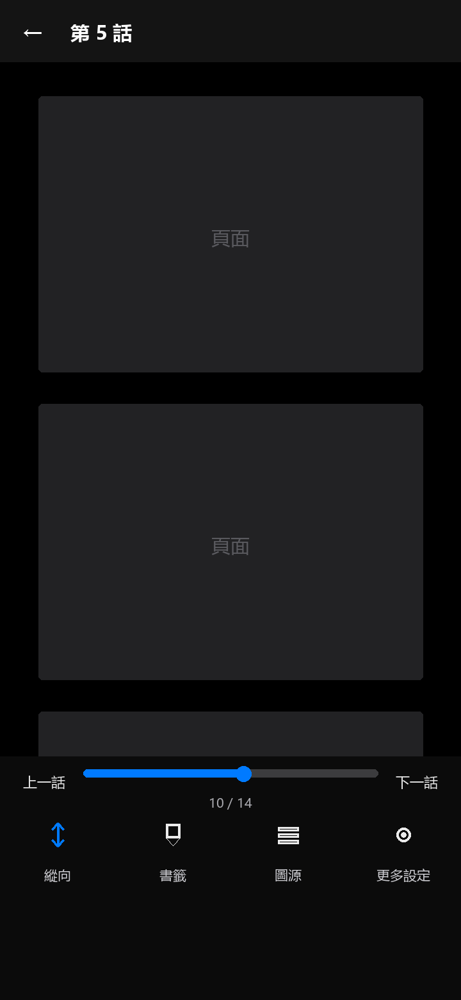
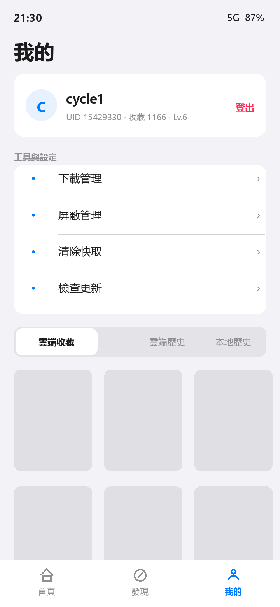

# JMReader

> 一个第三方 JM（18comic）Android 客户端。Kotlin + Jetpack Compose，单 Activity + overlay 栈，**没有 ViewModel、没有 DI 框架**，纯手写的轻量架构。

[](https://github.com/cycle123123123/cc/releases/latest)
[](#下载)
[](https://kotlinlang.org)
[](https://developer.android.com/jetpack/compose)
[](LICENSE)



## 功能

**浏览**

- 首页：最新上架、分区横滑、继续阅读、协议更新提示、下拉刷新、骨架屏
- 发现：分类（三排筛选，向下滚动自动收起、回顶自动展开）、标签、周榜、随机推荐
- 搜索：关键词 / 分类 / 排序，最近搜索 + 热门标签
- 全站统一 3 列封面网格：右上角「页数 · 日文」角标、底部点击/爱心、**触底自动加载**

**详情**

- 续读记忆：「继续第 N 话」胶囊 + 目录里对应的「續讀」标记
- 单话本自动隐藏「目录」页签，只保留 详情 / 评论
- 作者作品横滑推荐、标签单击搜索 / **长按直接屏蔽**、屏蔽作者
- 收藏、点赞、评论 / 回复 / 删除、单话下载

**阅读器**

- 纵向滚动 / 横向翻页，双击缩放，音量键翻页
- 底栏：页码拖动条 + 上一话 / 下一话 + 纵向·书签·图源·更多设置
- 进度保存、书签（只保留最新一条）、图源测速切换、亮度/方向锁定
- 换话自动从第 1 页开始，并预取下一话前三页

**我的**

- 登录前后同一套 iOS 分组样式：账号卡 / 工具与设置 / 内容区
- 云端收藏（收藏夹管理、长按移动）、云端历史、本地阅读历史（可清空）
- 下载管理、屏蔽管理、清除缓存、检查更新

**其他**

- 多线路自动测速（内置 4 个主站 + 远程线路清单），失败自动重新发现
- 内置更新：GitHub Release 检查 + 多镜像加速下载 + root 静默安装
- 离线阅读：已下载章节断网可开

## 截图

| 首页 | 详情 | 阅读器 | 我的 |
|:--:|:--:|:--:|:--:|
|  |  |  |  |

> 截图为界面示意图：封面与内页以灰块替代，避免展示成人内容。

## 下载

最新版本：**[jmreader.apk](https://github.com/cycle123123123/cc/releases/latest/download/jmreader.apk)**（约 1.7 MB）

- 支持 Android 7.0（API 24）及以上
- 应用内「我的 → 检查更新」可自动升级；有 root 时优先静默安装，否则走系统安装器

## 构建

```powershell
$env:JAVA_HOME='C:\Android\jdk-17'
$env:ANDROID_HOME='C:\Android\Sdk'
$env:PATH="C:\Android\jdk-17\bin;C:\Android\gradle-8.9\bin;$env:ANDROID_HOME\platform-tools;$env:PATH"

gradle :app:assembleDebug        # 调试包
gradle :app:testDebugUnitTest    # 62 个 JVM 单测
gradle :app:assembleRelease      # R8 压缩，产物 ~1.7 MB
```

## 架构

```
app/     MainActivity + JmApplication + AppContainer（单例集合，经 CompositionLocal 下发）
core/    纯 JVM：签名、AES 解密、分条还原、TtlCache、格式化
data/    JmRepository（门面）
         ├─ net/    HostManager / SessionManager / JmHttp / ApiClient / HostBenchmark
         ├─ page/   PageRepository / PageLoader / PageCache(200MB) / PageStore(48MB) / ImageHostManager
         ├─ local/  AuthStore / SecureStore / ContentFilter / ReadingHistory / SearchHistory / ReaderPrefs
         ├─ download/ DownloadRepository
         ├─ update/   UpdateChecker
         └─ model/    DTO + JmError + SeriesParser
ui/      theme / components / common / navigation
         home / discover / search / detail / reader / library（每屏一个目录）
```

设计取舍：

| 决策 | 原因 |
|---|---|
| 不用 ViewModel | 单 Activity + `android:configChanges` 已覆盖旋转，状态挂在 `Screen` 实例上即可跨页面保留 |
| 不用 DI 框架 | 依赖图很小，`AppContainer` + `CompositionLocal` 足够，省掉编译期开销 |
| 不用 Paging 3 | 只需「首页 + 加载更多 + 去重」，手写 `PagedList` 约 90 行，行为完全可控 |
| 手写状态 | 所有列表状态都是普通类 + Compose `mutableStateOf`，方便单测与调试 |

缓存分四层：OkHttp HTTP 256 MB、Coil 封面 200 MB、阅读页字节 200 MB、阅读位图 48 MB（每话一个实例）。

## 协议实现

- 请求头 `Token = md5(ts + secret)`、`Tokenparam = "{ts},2.1.13"`，另有 `Token-time` 等
- 响应体 AES-ECB 加密，密钥依次尝试两个内置 secret
- 图片为纵向分条乱序，条数由 `md5(aid + 文件名)` 末位决定，需在客户端还原

> 协议细节见 [`docs/API.md`](docs/API.md)，架构细节见 [`docs/ARCHITECTURE.md`](docs/ARCHITECTURE.md)。

## 测试

```
app/src/test  11 个文件 / 62 个用例
  ├─ 加密与签名
  ├─ 图片分条还原
  ├─ 目录 / 模型解析
  ├─ 屏蔽规则匹配
  ├─ 页缓存淘汰
  ├─ 版本比较
  ├─ 卡片角标拼装
  ├─ TtlCache（命中 / 过期 / LRU）
  └─ PagedList（首屏 / 追加去重 / 到底 / 错误保留）
```

UI 与仓库层暂无自动化测试，靠真机冒烟（首页 / 发现 / 详情 / 阅读器 / 我的 / 搜索 / 写操作）。

## 更新日志

见 [Releases](https://github.com/cycle123123123/cc/releases)。

## 免责声明

- 本项目为**个人学习与技术交流**用途，与内容提供方无任何关联，非官方客户端。
- App 不存储、不分发任何作品内容，所有数据均来自第三方接口，版权归原作者与原站所有。
- 请勿用于商业用途；请支持正版。使用本软件产生的一切后果由使用者自行承担。

## License

[MIT](LICENSE)
